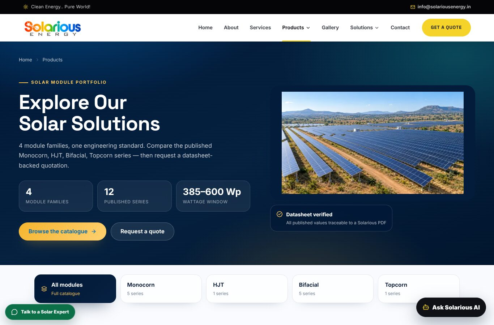
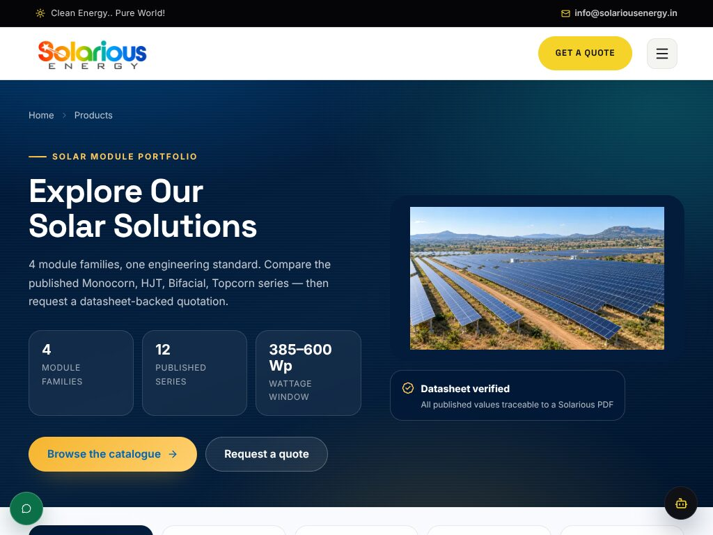
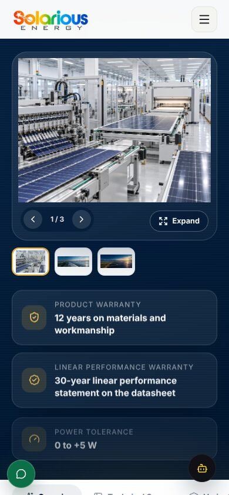
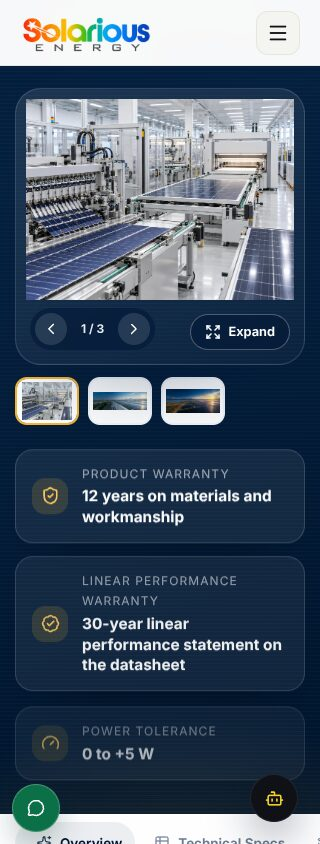
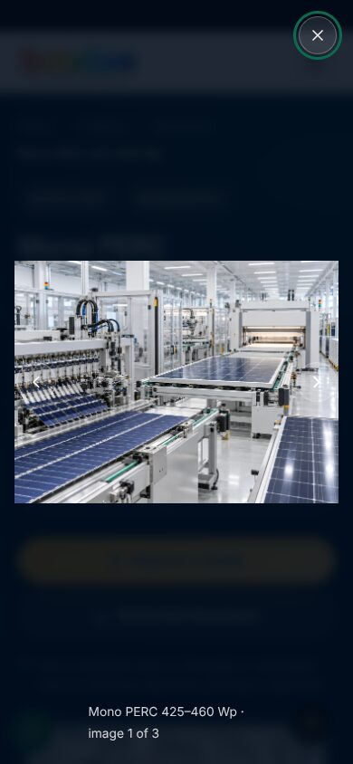
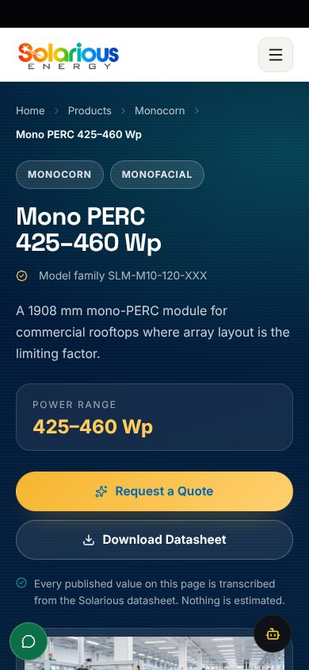
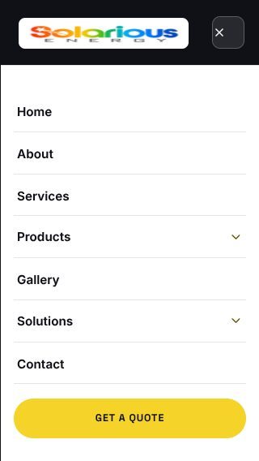
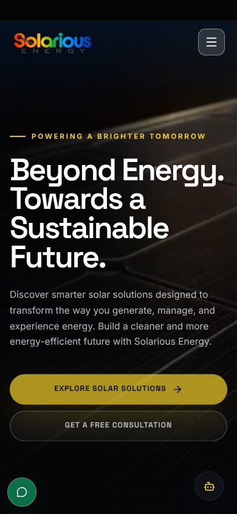

# Final Production-Level UI Fix — Solarious Energy

**Branch:** `arena/696c8b03-solariousbackend`
**Base:** `main` @ `7d67eef` (PR #17 already merged)
**Scope:** source-level UI fixes only. No redesign, no product-image replacement, no content edits, no backend/API changes.
**Verification build:** `next build --webpack` + `next start` on `0.0.0.0:3000`, tested in headless Chromium (Playwright).

---

## 1. Root causes

| # | Symptom | Actual root cause |
|---|---|---|
| 1 | Product/banner photographs cropped or with a missing edge | `next/image` was used with `fill`, which ships inline `position:absolute; inset:0`. The wrapper also had a fixed `min-height` and `overflow:hidden`, so the photograph was forced into a frame whose ratio did not match the asset. The verification badge was `position:absolute` over the same wrapper. |
| 2 | Carousel arrows / Expand button sat on top of the product photograph | `.ps-gallery-controls` and `.ps-gallery-expand` were both absolutely positioned inside the same figure. The figure only reserved space when the TSX added `has-controls`, which still did not create a control-free image area. |
| 3 | Full-screen gallery opened underneath the sticky header and product tab bar | The lightbox was rendered inside `.ps-page`, which creates its own stacking context. Header/tab-bar z-indexes therefore painted above it regardless of the lightbox z-index. |
| 4 | Hero/section content invisible with reduced motion or JavaScript disabled | Framer Motion's `initial={{opacity:0}}` is applied in the server HTML. On reduced-motion and no-JS paths the animation never runs, so the inline `opacity:0` remained. The CSS safety net targeted `.ps-motion-reveal`, but the reduced-motion render path did not add that class. |
| 5 | Active navbar item had a different underline on `/` and `/about` than on `/products` | Three competing legacy rules still existed: `.desktop-nav a.active:after` and `.desktop-nav a.active` in `globals.css`, plus `.nav-hover-menu.active:after` / `.desktop-nav a.active` in `usability.css`. They produced a 2 px underline at `bottom:19px` for `<a>` items and a 3 px underline at `bottom:0` for the `<button>` item. |
| 6 | A focus ring appeared on the gallery Expand button on page load | The “restore focus” effect ran on mount as well as on close, calling `.focus()` before any interaction. |
| 7 | Every product detail page loaded already scrolled down | `ProductTabNav` called `scrollIntoView({block:"nearest"})` on the active tab to centre it. On mount this scrolled **the document**, not just the horizontal strip. |
| 8 | Listing banner stacked at 1024 px even though there was room for two columns | The single-column fallback was declared in a breakpoint wider than the banner's own two-column breakpoint, so it overrode the desktop layout at 1024. |

---

## 2. Files modified

| File | Change |
|---|---|
| `app/product-system.css` | Rebuilt `.ps-hero-banner-media` as a normal-flow column with a 16:9 `contain` image and static badge; reserved a 64 px control strip under the gallery image; moved `.ps-gallery-expand` to the bottom strip; corrected the 900 px banner breakpoint; added reduced-motion/no-script visibility guarantees. |
| `components/product-motion.tsx` | Adds `ps-motion-reveal` on both the animated and reduced-motion render paths so the CSS guarantee always applies. |
| `components/product-image-gallery.tsx` | Portals the lightbox to `document.body`; restores focus only after a real close (`wasOpen` ref); removes the obsolete `has-controls` conditional. |
| `components/product-tab-nav.tsx` | Replaces document-level `scrollIntoView` with horizontal-only `strip.scrollTo()`. |
| `app/usability.css` | Removes the obsolete active-nav underline/colour rules that conflicted with the current design system. |
| `app/globals.css` | Removes the legacy `.desktop-nav a.active` colour and 2 px underline; keeps the compact floating CTA treatment. |
| `app/solarious-ui.css` | Unifies active/hover nav colour on `navy-900` so anchor items and dropdown items match. |
| `docs/ui-fix-evidence/*.jpg` | Rendered before/after verification screenshots (after state). |
| `UI-FIX-REPORT.md` | This report. |

No component was replaced, no section was removed, and no product image or catalogue data was changed.

---

## 3. Product-image fixes

**Banner / product media**

- Removed the fixed wrapper height and `overflow:hidden` from `.ps-hero-banner-media`. It is now a flex column with a normal-flow image plus a static verification badge below it.
- The `next/image` inline absolute positioning is deliberately neutralised **only** on this image (`position:static`, `inset:auto`, `width:100%`, `height:auto`) so the intrinsic 16:9 frame governs.
- `object-fit: contain`, `object-position: center`; no `cover`, no stretch, no fixed image height.
- The badge no longer occupies the photograph area at any width.

**Gallery**

- `.ps-gallery-main` reserves `64px` below the image for the carousel counter and Expand button.
- `.ps-gallery-expand` moved from `top:14px` (over the photo) to `bottom:14px` (inside the reserved strip).
- At 390 px: the gallery image ends at y=345, carousel controls start at y=353, Expand at y=359 — no overlap.
- At 320 px: the image ends at y=300, controls start at y=308, Expand at y=314 — no overlap.

**Measured results**

| Check | Result |
|---|---|
| Listing banner 1366 | Image `567×319`, `contain`, badge overlap **0 px** |
| Listing banner 1024 | Two columns retained; copy 478 px / photo 424 px |
| 15 viewport widths × `/products` | 13 images checked at every width, **0 bad** (all `contain`, opacity 1, visible, naturalWidth > 0, no clipped ancestor) |
| 15 viewport widths × `mono-perc-425-460` | 8 images checked at every width, **0 bad** |
| All 11 published detail routes at 390 | `ok` on every gallery/overview image (`contain`, opacity 1, intrinsic size loaded) |

No product image was cropped, zoomed, stretched, or clipped by its container in the final sweep.

---

## 4. Decorative numbering

- Audited 20 routes at 1280 px for standalone `01`–`09` text nodes.
- Only remaining match: **“03 bypass diodes”** in the G2B 575–600 electrical specification — a real technical value, intentionally retained.
- No decorative numbering containers, margins, padding, or alignment wrappers remain in the rendered pages.

---

## 5. Responsive fixes

| Area | Fix |
|---|---|
| Products banner | Two columns down to 901 px; single column at ≤900 px, photograph first. 1024×768 now shows copy and image side by side instead of an early stack. |
| Product gallery | Reserved bottom control strip at every width; at 320 px controls and Expand remain fully visible with a 35 px gap. |
| Lightbox | Portalled to `body`, z-index 120; at 390 px the image renders `358×269` fully inside the viewport, above the sticky header, with body scroll locked and focus restored on close. |
| Navigation | One active state at every route: navy label + 3 px gold underline at the header's lower edge. No duplicate/offset underline. |
| Product page entry | Document stays at `scrollY = 0` on load at all 13 tested desktop/tablet/mobile sizes. |
| Mobile menu | 320×568 sheet opens with 7 primary links plus the quote CTA; no horizontal overflow. |
| Global layout | 20 routes × 9 widths produced **0 px** horizontal overflow; the final 15-size detail sweep also produced **0 px**. |

### Viewports tested (full set)

`320×568`, `360×800`, `375×812`, `390×844`, `414×896`, `430×932`, `480×900`, `768×1024`, `820×1180`, `1024×768`, `1280×800`, `1366×768`, `1440×900`, `1600×900`, `1920×1080`.

---

## 6. Animation conflicts resolved

- **Reduced motion / no JS:** `.ps-motion-reveal { opacity:1; transform:none }` is enforced both under `prefers-reduced-motion: reduce` and under `@media (scripting: none)`. Every reveal on `/products` and the detail page is opacity `1` at 390, 768, 1024 and 1440; no hidden sections or images.
- **GSAP pinning:** verified the homepage story pin at 1024 and 1366. The pinned section stays at viewport top for the scrub range, then releases; no document-level overflow. `media.revert()` + `context.revert()` still run on unmount. `.premium-home { overflow:hidden }` does not break the pin because GSAP wraps the story in its own pin-spacer.
- **GSAP/Framer separation:** no element uses both libraries. Framer Motion only handles product reveals and the tab highlight; GSAP only handles homepage storytelling.
- **Scroll hijack removed:** product tab navigation no longer scrolls the document to itself on mount. Clicking a tab still scrolls to the chosen section intentionally; only the horizontal tab strip auto-centres.

---

## 7. Browser verification

All screenshots are from the production build after the fixes.

### Products listing — 1366×900

- Banner image and badge no longer overlap.
- Active Products nav underline is a single 3 px gold bar.
- No document scroll on load, no horizontal overflow.

### Products listing — 1024×768

- Two columns retained at 1024 (copy 478 px, photo 424 px).
- Image is fully contained, no crop.

### Product detail — 390×844

- Page loads at the top.
- Hero CTA and datasheet link are fully visible.
- Floating actions are compact 48 px icon buttons.

### Product gallery — 390 and 320

- Image above, controls below, Expand inside the reserved strip.
- No control covers the photograph.

### Gallery lightbox — 390

- Portalled above the sticky header (`z-index:120`, parent `BODY`).
- Image `358×269`, `contain`; close button focused; caption visible.

### Reduced motion — 390

- Identical visible content; all 17 `.ps-motion-reveal` nodes and both gallery images computed `opacity:1`.

### Mobile navigation — 320×568

- Sheet open, 7 primary links, no horizontal overflow.

### Homepage — 390

- Existing design, typography, imagery and animation preserved.

### Console / network results

Tested `/`, `/products`, `/products/mono-perc`, `/products/bifacial/g2b-575-600`, `/products/mono-perc/mono-perc-425-460`, `/about`, `/gallery`, `/contact`, `/quote`, `/events`:

- **0 failed image requests** (no 404/5xx image responses).
- **0 console errors** after excluding the expected local API 5xx responses.
- `/api/products`, `/api/team`, `/api/resources` return 5xx locally because `BACKEND_API_URL` is not configured in this sandbox; this is environmental and unchanged by the UI work.

---

## 8. Build, lint, type and test results

| Command | Result |
|---|---|
| `npm run typecheck` | **Pass** (`tsc --noEmit`) |
| `npm run build` | **Pass** — compiled successfully, all routes generated |
| `npm run lint` | **0 errors**, 23 pre-existing warnings (unused deps / `` in unrelated components) |
| `node --test tests/*.test.mjs` | **87 passed, 0 failed** |
| `npm --prefix backend test` | **136 passed, 0 failed** |
| Production server | `next start` on `0.0.0.0:3000` — ready |

---

## 9. Preserved behaviour

- Same visual identity, colours, typography, section order and copy.
- Same product catalogue, images, datasheets and links.
- Same GSAP homepage story, parallax, reveals and Framer Motion product animations.
- Same quote/contact/datasheet actions.
- No backend endpoint, payload or data model was changed.

---

## 10. Remaining issues / intentional decisions

1. **Floating WhatsApp and AI actions** are fixed overlays by design (the standard chat/help pattern). They are compacted to 48 px icon-only buttons at ≤1024 px; at desktop widths the labelled pills can overlap the lower-right corner of whatever content happens to be at the bottom of the viewport while scrolling. They do not affect layout, focus, or horizontal overflow and never cover the primary hero or purchase CTAs.
2. **The `GET A QUOTE` button below 650 px** is intentionally hidden in the header to protect the logo/hamburger composition; the quote CTA remains in the mobile sheet and in the page hero/CTA sections.
3. **The “Datasheet pending” pill** on HJT/TOPCon cards is an intentional catalogue-status overlay in the image's top-right padding. It does not cover the module itself and was left unchanged.
4. **Deployment was not performed** — this change set is delivered as a pull request only.
